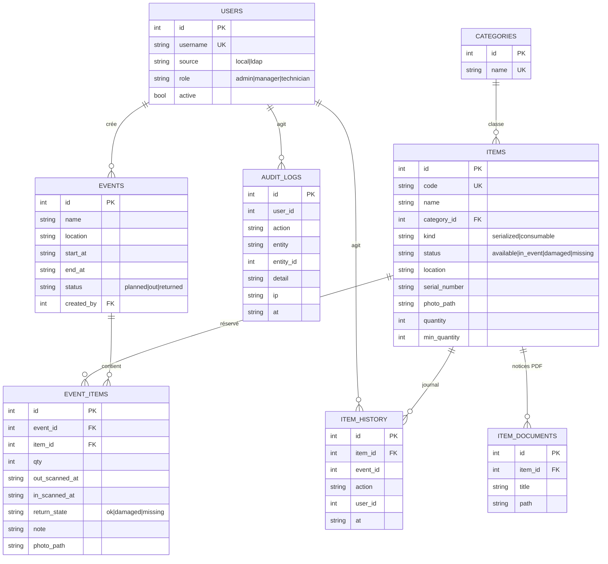

# Modèle de données : Simplimo +

Règles clés
- `EVENT_ITEMS` est unique par (événement, article). Le chevauchement de périodes est refusé (HTTP 409) pour les articles `serialized` dont l'autre événement est `planned` ou `out`.
- Départ : article sérialisé passe à `in_event`, consommable décrémenté de `qty`. Retour : `available`, `damaged` ou `missing` ; consommable recrédité.
- Les dates sont stockées en ISO 8601 UTC (texte) pour fonctionner à l'identique sur SQLite et PostgreSQL.
- Les rôles LDAP sont recalculés à chaque connexion depuis `memberOf` (variables `LDAP_GROUP_*`).
